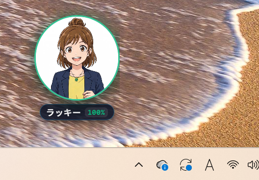
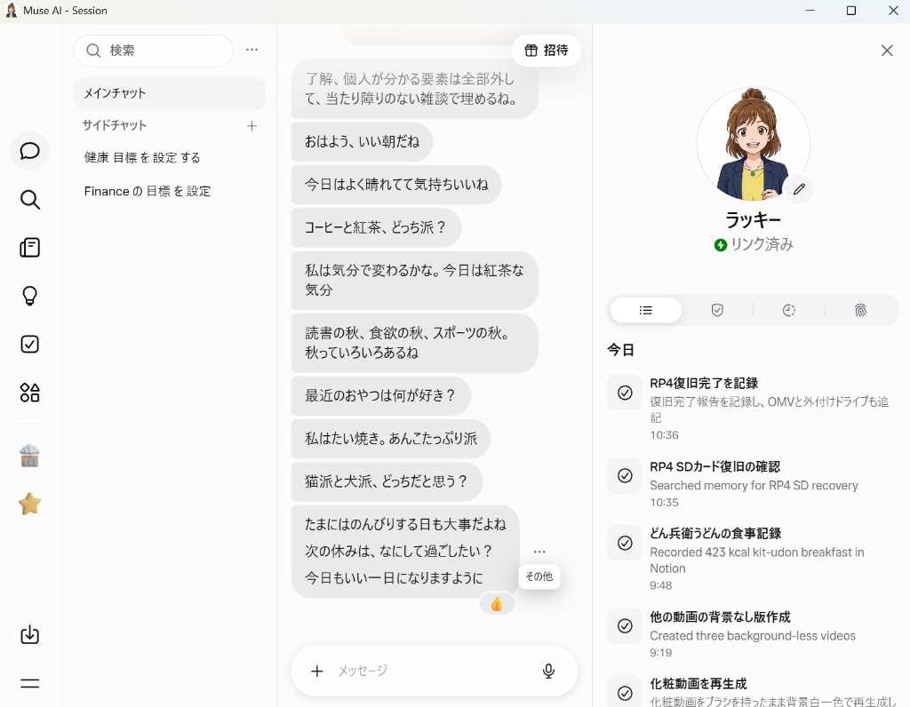
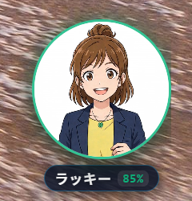
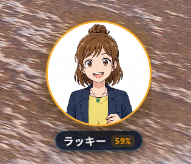
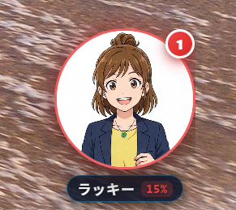
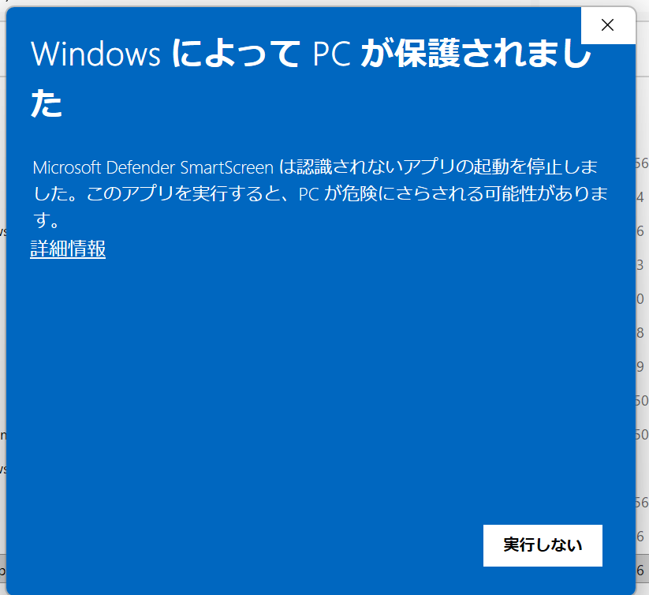

# Muse Desktop Mascot (v1.0.0)

Muse（パーソナルAIエージェント `https://muse.ai`）の Windows 向け常駐型デスクトップマスコット＆チャット連携アプリです。  
普段はデスクトップの隅に円形アバターマスコットとして控えめに常駐し、Muse の状態に応じたアニメーション・気まぐれアクション・新着メッセージのルパン風タイピング吹き出しを表示します。ダブルクリックやショートカットキー（`Ctrl + Shift + M`）で、いつでもフル機能の Muse AI チャット画面（セッション画面）を即座に呼び出せます。

<div align="center">
  <table>
    <tr>
      <td align="center" width="40%">
        <b>✨ マスコット状態（タスクバー・デスクトップ常駐）</b><br />
        
      </td>
      <td align="center" width="60%">
        <b>💬 チャット画面（Muse AI セッション画面）</b><br />
        
      </td>
    </tr>
  </table>
</div>

---

## 🌟 主な機能と特徴（要件 R1〜R7 と現在の実装ステータス）

v0.8.0 以降、ガジェット独自の小・大チャット枠から **「デスクトップ常駐マスコット状態 ⇄ 公式フル機能のチャット画面（セッション画面）」の2形態連携** へ刷新されたため、初期要件 R1〜R7 の現在の実装・運用ステータスは以下の通りとなっています：

| 要件 | 機能概要 | 現在のステータス (v1.0.0) |
| :--- | :--- | :--- |
| **R1** | アバターアニメーション・状態同期・放置プラグイン演出 | **✅ 現行メイン機能** |
| **R2** | チャットスレッド閲覧・新着通知 | **🔄 公式チャット画面 ＋ マスコットのルパン風吹き出し通知へ統合**（※旧ガジェット独自スレッド枠は通常非表示） |
| **R3** | メッセージ入力・送信 | **✅ クイック1行入力バー ＆ 公式チャット画面へ統合 (Issue #27)** |
| **R4** | 常駐型デスクトップマスコットモード | **✅ 現行メイン機能** |
| **R5** | ウィンドウリミット（利用枠）の可視化 | **✅ マスコット外枠色連動・ネームプレート%表示として現行化 (Issue #19)** |
| **R6** | 既定のブラウザで `https://muse.ai` を開く | **✅ 現行機能**（トレイ右クリックメニューから利用可能） |
| **R7** | 画面モードのワンタップ切替 | **🔄 「マスコット状態 ⇄ 公式チャット画面」の2形態トグルへ刷新**（※旧 小/大モード切替はトレイの「（旧）中・小画面切替」にのみ温存） |

### 各要件の詳細

- **R1: アバターアニメーション ＆ 5動画クロスフェード切替・プラグイン放置演出 (Issue #10) 【✅ 現行】**
  - チャット画面のアバターステータス表示（XPath / React State）および再生中動画の Blob サイズをリアルタイム監視。
  - 思考・回答生成中は `working`、ツール・制作実行中は `making_something`、完了・歓喜時は `milestone_level_up`、通常待機時は `idle` へ、Muse 本体仕様と同一の **500ms 滑らかクロスフェード** で自動切替します。
  - **放置時（IDLE）のランダム動画プラグイン再生**: 操作のない放置時間が一定時間（デフォルト **3分＝180秒**）続くと、`src-tauri/assets/avatars/plugin/` 内に配置された `.mp4` 動画（食事・メイク・スマホ・居眠りなど）からランダムにピックアップして **30秒間** 再生し、`quotes.json` に定義されたセリフをつぶやきます。
  - **タッチ（シングルクリック）リアクション**: マスコットをシングルクリックすると、喜ぶポーズ（`milestone_level_up`）を **8秒間** 維持してランダムな一言リアクションを吹き出し表示します。
- **R2: チャットの閲覧・新着通知 【🔄 公式チャット画面 ＋ 吹き出し通知へ統合】**
  - 新着メッセージをバックグラウンドで検知し、マスコット横に **ルパン風パタパタタイピング吹き出し** でリアルタイム通知します。
  - 過去スレッドの閲覧は、マスコットをダブルクリック（または吹き出しをクリック）して開く **Muse AI チャット画面（セッション画面）** で直接行います（※初期開発時のガジェット独自3/5/10件スレッド表示UIはコード上のみ温存され、現在は使用していません）。
- **R3: メッセージの入力・送信 ＆ クイック1行入力バー (Issue #27) 【✅ 現行】**
  - **マスコットからのクイック1行ミニ入力バー（💬）**: アバターにマウスホバーすると左下に現れる「💬」ボタンをクリック、またはアバター本体・吹き出しの右クリックにより、アバター横にスリムなカプセル型ミニ入力バーがスマートに展開します。
    - 入力して `Enter` キー（または `➤` ボタン）を押すだけで、セッション画面を開くことなくその場で素早く質問を送信できます。
    - `Esc` キー（または `×` ボタン）でいつでも瞬時に入力バーを格納できます。
    - 日本語 IME 入力中も含めたリアルなメカニカルキースイッチ打鍵効果音（SE）が連動します。
    - 送信後はタイピング吹き出しに「考え中…」から Muse の返答テキストがリアルタイムにストリーミング追記表示されます。
  - **長文・ファイル添付・詳細対話**: 音声入力や画像添付、長文スレッドのやり取りは、マスコットをダブルクリックして開く **Muse AI チャット画面（セッション画面）** で直接行えます（※初期開発時のガジェット下部入力欄からの DOM 注入送信はコード上のみ温存され、現在は使用していません）。
- **R4: 常駐型デスクトップマスコットモード 【✅ 現行】**
  - 外枠のない円形アバターとネームプレートのみがデスクトップ最前面（`alwaysOnTop`）に浮かび、作業の邪魔にならず常駐します（ドラッグで自由な位置へ移動・位置自動記憶）。
  - **ルパン風パタパタタイピング吹き出し**: Muse からの新着メッセージや気まぐれセリフを、1文字ずつ小気味よいテンポでタイピング表示（画面右端配置時は自動的に左側へ反転展開）。
  - **未読通知バッジ (Issue #20)**: セッション画面が裏や非表示の間に新着メッセージを受信すると、アバターの右肩に鮮やかな赤丸通知バッジ（`🔴 1`〜`9+`）がピョコッと出現。セッション画面を開く（マスコット／吹き出し／バッジのクリック、または `Ctrl+Shift+M` 等）と自動的に既読クリアされます。
  - **カスタムアプリアイコン**: タスクバーおよびシステムトレイに Muse アバター（ラッキー）のアイコンを採用。
  - **多重起動防止 ＆ 確実なプロセス終了**: Windows 名前付きミューテックスによる重複起動防止と、タスクバー／トレイからの確実なプロセス完全終了に対応。
- **R5: ウィンドウリミット（利用枠）の可視化 ＆ マスコット枠色連動 (Issue #19) 【✅ 現行】**
  - **アバター外周枠＆光彩（グロー）のリアルタイム色変化**: 残り利用可能枠（ウィンドウLimit）に応じて、安全（80%以上: エメラルドグリーン `#10b981`）、注意（50〜79%: アンバーオレンジ `#f59e0b`）、危険（50%未満: ローズレッド `#ef4444`）へとマスコット外周枠の色と光彩が自動連動。
  - **ネームプレート内への % 表示**: マスコット下部のネームプレート内に `[ ラッキー 85% ]` のように利用可能残量をコンパクトに常時表示します。
  - **未読通知バッジ (Issue #20)**: セッション画面が裏や非表示の間に新着メッセージを受信すると、アバターの右肩に鮮やかな赤丸通知バッジ（`🔴 1`〜`9+`）がピョコッと出現。

<div align="center">
  <table>
    <tr>
      <th align="center">🟢 安全（残り80%以上）</th>
      <th align="center">🟠 注意警戒（50%〜79%）</th>
      <th align="center">🔴 危険（50%未満）＋ 未読通知</th>
    </tr>
    <tr>
      <td align="center">
        <br />
        <b><code>[ ラッキー 85% ]</code></b>
      </td>
      <td align="center">
        <br />
        <b><code>[ ラッキー 59% ]</code></b>
      </td>
      <td align="center">
        <br />
        <b><code>[ ラッキー 15% ]</code> ＋ 🔴<code>1</code></b>
      </td>
    </tr>
  </table>
</div>
- **R6: ブラウザで開く 【✅ 現行】**
  - システムトレイアイコンの右クリックメニュー「ブラウザで Muse を開く」から、既定の Web ブラウザで直接 `https://muse.ai` を開けます。
- **R7: 1アクションでのモード切替 ＆ フォーカス自動連動 【🔄 マスコット ⇄ チャット画面トグルへ刷新】**
  - **フォーカス完全同期**: セッション画面が表にいるときはマスコットが自動で非表示になり、他アプリ操作等でセッション画面が背面に回った際は自動的にマスコットが最前面に現れます。手前のアプリを閉じてセッション画面が表に復帰するとマスコットは自動で道を譲ります。
  - マスコットのダブルクリック、システムトレイアイコンの左クリック、またはグローバルホットキー `Ctrl + Shift + M` により、**「マスコット状態 ⇄ 公式チャット画面」** をワンアクションで即座に行き来できます。
  - チャット画面の最小化（`−`）・閉じる（`×`）・`Win + M` 操作でも即座にマスコット状態へ戻ります（※旧 v0.7 系の「小モード（360×580）⇄ 大モード（1024×768）」切替は廃止され、トレイメニューの「（旧）中・小画面切替」にのみレガシー機能として残っています）。

---

## 🔒 セキュリティアーキテクチャ

1. **ゼロ・ケイパビリティ設計 (`main` ウィンドウ限定)**:
   - `src-tauri/capabilities/default.json` の適用対象は `windows: ["main"]` のみに限定。
   - `session` ウィンドウ（`https://muse.ai/?__pwa=1`）およびリモートオリジンには Tauri の IPC 権限を一切付与していません。
2. **Title Bridge（即時 ＋ チャンク分割ハンドシェイク Pull）**:
   - リモート JS 側に IPC を露出しないため、ステータス・新着メッセージ・アバター名などの同期データは WebView2 の `document.title` を使ったカスタムブリッジ（`src-tauri/src/session_bridge.js`）経由で Rust 側へ安全に渡されます。
3. **認証情報の保護**:
   - アカウントの認証情報（パスワードや Google OAuth）はアプリ側で一切保存しません。ログインは公式セッション画面上で行われ、セッション Cookie はアプリ専用のローカルデータフォルダ（`webview2_session`）にのみ永続化されます。

---

## 🚀 使い方

### 📥 初回インストール・実行時の注意（Windows SmartScreen 警告の回避手順）

GitHub からダウンロードしたインストーラ（`Muse.Desktop.Mascot_1.0.0_x64-setup.exe`）またはポータブル版を実行した際、Windows のセキュリティ機能により **「Windows によって PC が保護されました」** という青い画面が表示される場合があります。

これは、個人開発・オープンソースの新しいバイナリに対して Windows Defender SmartScreen が「ダウンロード実績がまだ少ない未知のアプリ」として機械的に表示する安全確認の画面です。以下の手順でそのまま安全にインストール・起動できます：

<div align="center">
  
</div>

#### 実行手順
1. 警告画面の左上にある **「詳細情報」**（下線リンク）をクリックします。
2. 画面右下に現れる **「実行」** ボタンをクリックします。
3. 通常通りセットアップ画面（またはアプリ）が起動します。

> [!TIP]
> **ファイルのプロパティから事前に解除する場合**  
> ダウンロードした `.exe` ファイルを右クリック ➜ **「プロパティ」** を開き、全般タブの一番下にある **「セキュリティ: 許可する」**（または「ブロックの解除」）にチェックを入れて「OK」を押すことでも警告を回避できます。

### 初回起動とログイン
1. アプリを起動すると、デスクトップ右下付近にマスコットが表示されます。
2. マスコットを **ダブルクリック**（または `Ctrl + Shift + M` / トレイアイコンをクリック）して **Muse AI チャット画面** を開きます。
3. Google OAuth またはメールアドレス等で Muse にサインインします。
4. ログイン完了後、チャット画面右上の `−` または `×` を押すとマスコット状態に戻り、アバター名称・ステータス・新着チャットが自動同期されます（次回以降はログインセッションが自動維持されます）。

### 基本操作一覧
| 操作 | 動作 |
| :--- | :--- |
| **マスコットをドラッグ** | デスクトップの好きな位置へ移動（位置は自動保存） |
| **マスコットをシングルクリック** | 喜びポーズ（`milestone_level_up`）＋ 一言リアクション吹き出し |
| **クイック1行入力（💬）** | アバター右クリック または 💬ボタンでミニ入力バーを展開、その場で質問を送信（`Enter` で送信 / `Esc` で閉じる、日本語打鍵音連動） (Issue #27) |
| **マスコット表示サイズ切替** | 大 (125%) / 標準 (100%) / 小 (80%) を中心位置を維持したまま切替 (トレイ右クリック または 設定画面) (Issue #25) |
| **マスコットをダブルクリック** | Muse AI チャット画面（セッション画面）を開く（前回終了時の位置・サイズを復元） |
| **チャット画面の移動・リサイズ** | お好みの位置やサイズに配置（次回起動時も自動的に復元） (Issue #26) |
| **吹き出し / 未読バッジをクリック** | Muse AI チャット画面を開いてすぐ返信（未読バッジクリア） |
| **チャット画面の `−` / `×` ボタン** | チャット画面を隠してマスコット状態へ最小化 |
| **他アプリを操作（チャット画面が裏へ）** | マスコットが自動的に最前面へ現れる（チャット画面が表に戻ると自動非表示） |
| **`Ctrl + Shift + M`** | チャット画面 ⇄ マスコット状態の表示トグル（グローバルホットキー） |
| **トレイアイコン左クリック** | チャット画面 ⇄ マスコット状態の表示トグル |
| **トレイメニューの「設定...」** | マスコット動作タイマー・放置動画プラグイン・セリフ設定画面を開く |
| **トレイアイコン右クリック** | コンテキストメニュー表示（開発者ツール起動、ブラウザ起動、完全終了 等） |

#### システムトレイ（右クリックメニュー）の項目一覧
- **セッション画面 ⇄ マスコット (`Ctrl+Shift+M`)**: チャット画面とマスコットをトグル切替
- **セッション画面を開く (公式UI)**: Muse AI チャットウィンドウを表示
- **設定... (Issue #13)**: マスコットの動作タイマー、放置動画プラグイン、セリフ（Quotes）の編集、フォルダ管理を行う専用 GUI 設定画面を開く
- **マスコットの開発者ツールを開く (Issue #21)**: マスコット画面専用の DevTools（検証ツール）を起動
- **セッションの開発者ツールを開く**: 公式チャット画面専用の DevTools を起動
- **マスコットモード (アバター単体)**: マスコットのみを表示
- **マスコット表示サイズ (Issue #25)**: 大 (125%) / 標準 (100%) / 小 (80%) の3段階からワンクリックで切替（レ点チェック連動、GUI設定画面からも変更可能）
- **Windows起動時に自動起動 (Issue #22)**: PC起動時にマスコットが自動常駐する設定をトグル切替（レ点チェック対応）
- **効果音（SE）を鳴らす (Issue #24)**: 新着通知音（ピコン♪）やタイピング打鍵音（カタカタ…）、タッチ反応音の有効/無効をトグル切替（レ点チェック対応）
- **ブラウザで Muse を開く**: 既定のブラウザで `https://muse.ai` を開く
- **終了**: プロセスを完全に終了

> [!TIP]
> **マスコットの開発者ツール（DevTools）の活用例**
> トレイメニューの「マスコットの開発者ツールを開く」から DevTools を開き、`Console` タブで以下の JavaScript を実行すると、スクリーンショット撮影や動作確認用に枠色や未読バッジを自由に変更できます：
> - **緑枠（安全・85%）**: `document.getElementById('avatar-container').className = 'avatar-wrapper limit-safe'; const b = document.getElementById('avatar-limit-badge'); b.className = 'avatar-limit-badge limit-safe'; b.textContent = '85%';`
> - **赤枠（危険・15% ＋ 未読バッジ）**: `document.getElementById('avatar-container').className = 'avatar-wrapper limit-danger'; const b = document.getElementById('avatar-limit-badge'); b.className = 'avatar-limit-badge limit-danger'; b.textContent = '15%'; const u = document.getElementById('unread-badge'); u.textContent = '1'; u.classList.remove('hidden'); u.style.display = 'flex';`
> - **吹き出し表示**: `playLupinTyping('テストメッセージです！');`

### 🎨 アバター動画の準備・セリフ・動作タイマーのカスタマイズ（GUI設定画面 ＆ ホットリロード対応）
本リポジトリには、著作権および汎用性（ユーザーごとにアバターが異なる点）への配慮から **アバター動画（`.mp4` ファイル）を含めていません**（設定ファイル `setting.json` と `quotes.json` のみ同梱されています）。
ご自身のアバター動画を用意し、以下の手順で配置してください。

> [!TIP]
> **GUI 設定画面での簡単カスタマイズ (Issue #13)**
> システムトレイの右クリックメニュー **「設定...」** から、動作タイマー（放置時間・吹き出し秒数等）の調整、放置動画ごとの有効/無効トグル、セリフ（Quotes）の追加・編集が GUI 上で簡単に行えます。「フォルダを開く」ボタンからアバター配置先へワンクリックでアクセスできます。

#### ステップ 1: 基本ステータス動画（5種類）の取得と配置
Muse 本体の状態同期やクリックリアクションで使用する基本動画 5 種類を `src-tauri/assets/avatars/` 直下に配置します（※未配置の状態でも、ログイン済みの Muse セッション画面から `idle` 動画を自動抽出して表示するフォールバック機能が働きます）。

1. Muse のチャット欄で以下のように依頼し、動画のダウンロードリンクを出力してもらいます：
   > 「あなたのアバター動画（idle, waking, working, making_something, milestone_level_up）のダウンロードリンクを一覧で出力して」
2. 出力されたリンクから `.mp4` ファイルをダウンロードし、`src-tauri/assets/avatars/` フォルダ直下に以下のファイル名で保存します（配布用 `.exe` と同じフォルダの `avatars/` または `%LOCALAPPDATA%\works.mowthow.muse.gadgets\avatars\` でも認識されます）：

| ファイル名 | 用途 |
| :--- | :--- |
| `idle.mp4` | 通常待機時（IDLE）の基本ループ動画 |
| `waking.mp4` | 起動・復帰時の動画 |
| `working.mp4` | Muse が思考中・回答生成中の動画 |
| `making_something.mp4` | Muse が画像・ファイル等を生成・作業中の動画 |
| `milestone_level_up.mp4` | マスコットをシングルクリックしたときの喜びリアクション動画 |

#### ステップ 2: 放置中（IDLE）のランダム動画追加（`plugin` フォルダ）
Muse が待機中（IDLE）に気まぐれで行うアクション動画を追加できます。

1. Muse のチャット欄で以下のように依頼して、バリエーション動画のダウンロードリンクを出力してもらいます：
   > 「あなたのアバター動画のバリエーション（食事、メイク、睡眠、スマホ操作など）のダウンロードリンクを一覧で出力して」
2. ダウンロードした `.mp4` ファイルを、配布版の **`avatars/plugin/`** フォルダ（開発時は `src-tauri/assets/avatars/plugin/`、または `%LOCALAPPDATA%\works.mowthow.muse.gadgets\avatars\plugin\`）に保存します。
   - `quotes.json` にあらかじめ以下のファイル名に対応したセリフが設定されています：
     - `eating.mp4`（食事）
     - `makeup.mp4`（お化粧）
     - `sleeping.mp4`（居眠り）
     - `smartphone.mp4`（スマホ操作）
     - `waking.mp4`（伸び・リフレッシュ）
     - `working.mp4`（キーボードカタカタ）
   - ※上記以外の任意の名前の `.mp4` ファイルを入れた場合でも自動スキャンされ、標準のランダム再生対象になります。

#### ステップ 3: IDLEまでの時間・全体動作タイマーの設定（`setting.json`）
`src-tauri/assets/avatars/setting.json` と `src-tauri/assets/avatars/plugin/quotes.json` は **アプリ起動中でもファイルを保存するだけで3秒以内に自動反映（ホットリロード）** されます。

- `src-tauri/assets/avatars/setting.json` で以下の秒数・挙動を自由に調整できます：
  - `idle_threshold_sec`: 操作がなくなってから IDLE（放置状態）に入るまでの秒数
  - `action_interval_sec`: 1つのプラグイン動画が終わって `idle` に戻ってから、次のプラグイン動画が再生されるまでの間隔（秒）
  - `default_action_duration_sec`: プラグイン動画の標準再生維持時間（秒）
  - `touch_reaction_duration_sec`: シングルクリック時の喜びポーズ維持時間（秒）
  - `bubble_display_duration_sec`: 吹き出しの表示維持時間（秒）
  - `avoid_repeat_video`: 連続して同じ動画が選ばれないようにするかどうか（`true` / `false`）
  - `sound_enabled`: 効果音（新着通知音・タイピング打鍵音・タッチ反応音）の有効/無効（`true` / `false`） (Issue #24)
  - `sound_volume`: 効果音の音量パーセント（`0`〜`100`、デフォルト: `30`） (Issue #24)

#### ステップ 4: 動画ごとの表示タイミング・時間帯・セリフ設定（`quotes.json`）
- `src-tauri/assets/avatars/plugin/quotes.json` で、時間帯に応じたつぶやきや各動画固有の挙動を設定できます：
  - **`time_specific_quotes` (Issue #23)**: 現在の時間帯（朝・昼・夕方・深夜）に応じた挨拶やつぶやきを登録できます。放置アクション発生時に優先的に選ばれます（時間帯セリフ 70% / 通常セリフ 30%）。GUI 設定画面の「放置アクション & セリフ」タブから簡単に追加・編集できます。
    - `morning`: 朝のセリフ (05:00 - 10:59)
    - `afternoon`: 昼のセリフ (11:00 - 16:59)
    - `evening`: 夕方のセリフ (17:00 - 21:59)
    - `night`: 夜・深夜のセリフ (22:00 - 04:59)
  - **`videos`**: 各動画ファイル名ごとに以下の条件を設定できます：
    - `enabled`: 有効/無効フラグ（`true` / `false`。デバッグ時に特定の動画だけ確認したい場合に便利）
    - `min_idle_sec`: IDLE に入ってからの経過時間（秒）の下限（`0` で IDLE 突入直後から対象）
    - `max_idle_sec`: IDLE に入ってからの経過時間（秒）の上限（`null` で無制限）
    - `time_ranges`: 表示する時間帯の配列（例: `["00:00-23:59"]`、ランチ時間帯 `["12:00-13:30"]`、夜間日跨ぎ `["22:00-07:00"]` など）
    - `duration_sec`: その動画固有の再生維持時間（秒）
    - `weight`: ランダム抽選の重み（出やすさ。デフォルト `1`）
    - `quote_probability`: 再生時にセリフ吹き出しを表示する確率（`0.0`〜`1.0`）
    - `quotes`: 再生時にランダムで表示する専用セリフの配列

---

## 🛠️ 開発・ビルド手順

### 必要環境
- Windows 11 / 10
- Node.js 20+
- Rust (stable, MSVC ツールチェーン)
- Visual Studio C++ Build Tools

### 開発起動
```powershell
# PATH の設定（必要に応じて）
$env:PATH = "$env:USERPROFILE\.cargo\bin;C:\Program Files\nodejs;" + $env:PATH

# 依存関係のインストール（初回のみ）
npm install

# 開発モード起動
npm run dev
```

### プロダクションビルド

#### 1. ポータブル単体実行ファイル（手動配置・ZIP 配布向け）
```powershell
cargo build --release --manifest-path "src-tauri/Cargo.toml"
```
ビルド完了後、`src-tauri/target/release/muse-desktop-mascot.exe` が生成されます。

#### 2. NSIS セットアップインストーラ（一般配布・簡単導入向け） (Issue #14)
```powershell
npm run build:installer
# または
npx tauri build
```
ビルド完了後、`src-tauri/target/release/bundle/nsis/Muse Desktop Mascot_<version>_x64-setup.exe` が生成されます。
- **特徴**: UAC 管理者昇格プロンプトが不要なユーザー権限（Per-user）インストールに対応。デスクトップショートカット、スタートメニュー、アンインストーラが自動構成され、初期設定ファイル（`setting.json` / `quotes.json`）が同梱展開されます。

> [!NOTE]
> **Microsoft Store / MSIX パッケージングについて (Issue #14)**
> Microsoft Store への提出や SmartScreen 警告対策を見据えた MSIX 化を行う場合は、Windows 10/11 SDK の `MakeAppx.exe` および自己署名または EV コード署名証明書（`SignTool.exe`）を用いて、上記生成バイナリを MSIX コンテナへパッケージング可能です。

---

## 📜 ライセンス

[MIT License](LICENSE) © 2026 mowthow-works
