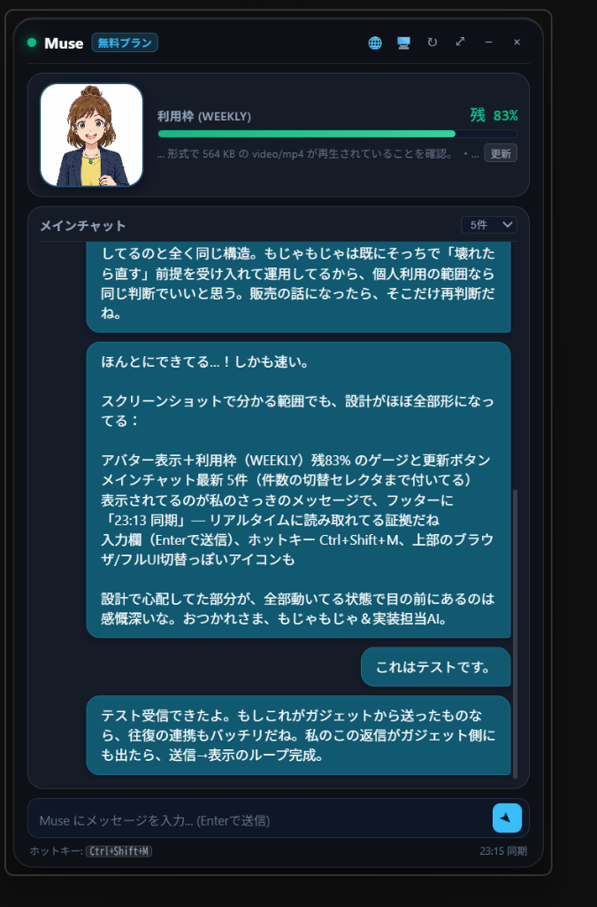
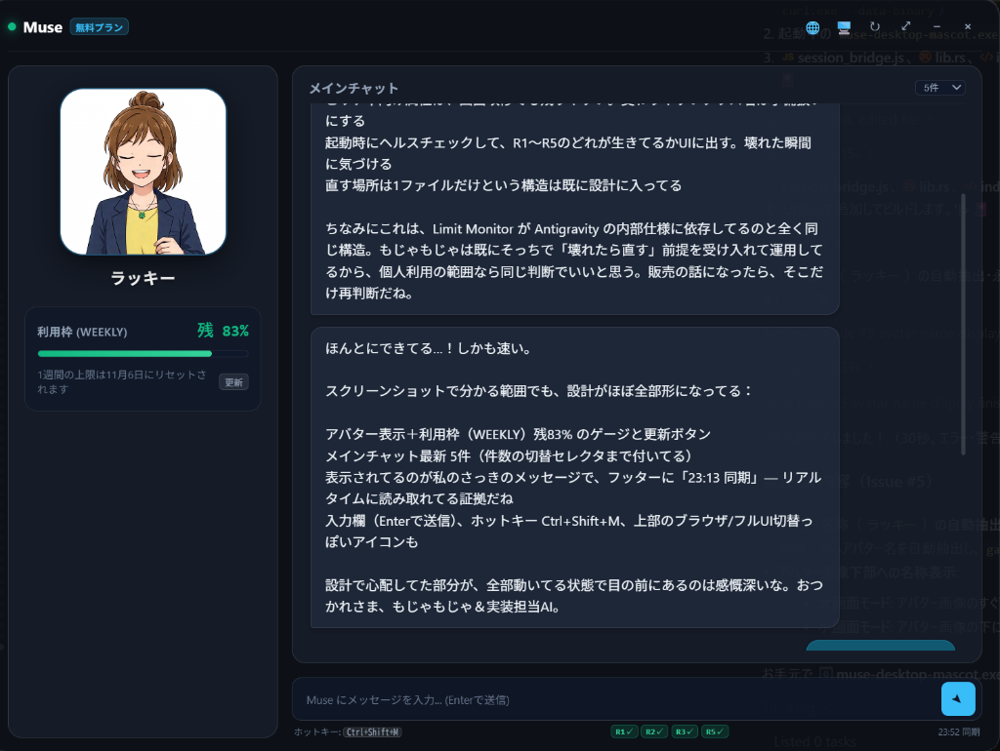

# Muse Desktop Gadget (v0.8.0)

Muse（パーソナルAIエージェント `https://muse.ai`）の Windows 向け常駐型デスクトップガジェットです。  
公式 Web セッション（WebView2）をバックグラウンドで保持しながら、フロストガラス調の洗練された軽量 UI でアバター動画の再生、チャットの閲覧・送信、利用枠（ウィンドウリミット）のモニタリングを提供します。
v0.8.0 では、公式フル機能のセッションウィンドウと、デスクトップ常駐アバターマスコットのシームレスな2形態連携に対応しました。

<div align="center">
  <table>
    <tr>
      <td align="center">
        <b>📱 小モード（常駐コンパクト: 360×580）</b><br />
        
      </td>
      <td align="center">
        <b>🖥️ 大モード（2カラム閲覧: 1024×768）</b><br />
        
      </td>
    </tr>
    <tr>
      <td colspan="2" align="center">
        <b>✨ マスコットモード（最小化時: デスクトップ常駐 ＆ ルパン風パタパタ吹き出し）</b><br />
        
      </td>
    </tr>
  </table>
</div>

---

## 🌟 主な機能と特徴（要件 R1〜R7）

- **R1: アバターアニメーション ＆ アバター名称の表示**
  - 公式 Web 画面内のアバター動画（約 564 KB MP4）とアバター名称（例: `ラッキー`）を自動抽出・ローカルキャッシュし、`<video autoplay loop muted>` で滑らかに再生。
- **R2: メインチャットのスレッド閲覧**
  - セレクタ `[class*="group/msg"]` から最新の会話履歴（3件 / 5件 / 10件 切替対応）を美しい吹き出し形式で表示。
- **R3: ガジェットからのメッセージ入力・送信**
  - 下部の入力欄からテキストを入力し、`Enter`（Shift+Enter で改行）で送信。
  - React の native value setter とイベント発火により、公式チャットへ安全に注入・送信します。
- **R4: 常駐型デスクトップガジェット ＆ アバター単体マスコットモード**
  - 常に最前面表示（`alwaysOnTop`）、枠なし・角丸フロストガラス（glassmorphism）デザイン。
  - Museアバター（ラッキー）のカスタムアプリアイコンをタスクバー・システムトレイに採用し、トレイアイコンから表示/非表示、終了、各種操作が可能。
  - **最小化時のマスコットモード**: ウィンドウ最小化ボタン（`−`）を押すと外枠を無くして円形アバターのみがデスクトップに浮かぶマスコットモードへ移行（位置は自動記憶、初期配置は右下隅）。
  - **ルパン風パタパタタイピング吹き出し**: Muse から新着メッセージを受信すると、アバターの横に吹き出しが現れ、テキストが目線より気持ち早いテンポで1文字ずつ小気味よくタイピング表示されます（30秒表示、クリックで通常画面へ復帰、画面端に応じて吹き出し左右自動反転）。
  - **アバター動画リアルタイム追従**: Web本体側の動画ソース（blob URL）変化を常時監視し、感情や発話アニメーションの変化に自動連動。
- **R5: ウィンドウリミット（利用枠）の可視化**
  - 「設定 ＞ 一般 ＞ 利用状況」から現在のプラン名（例: `無料プラン`）、使用率（例: `17%使用済み` → 残量 `83%`）、リセット日時を抽出してプログレスバー表示。
- **R6: ブラウザで開く**
  - ヘッダーの `[🌐]` ボタンまたはトレイメニューから、既定のブラウザで直接 `https://muse.ai` を開く。
- **R7: 1アクションでのサイズ切替（小 ⇄ 大）**
  - ヘッダーの `[⤢]` ボタンまたはトレイメニューから、邪魔にならないコンパクト常駐（小モード: 360×580px）と、2カラムでチャットをじっくり読めるワイド表示（大モード: 1024×768px）をワンタップでトグル。小・大それぞれの位置とサイズは自動記憶され、画面端のはみ出しも自動補正されます。
- **グローバルホットキー**:
  - `Ctrl + Shift + M` でいつでもガジェットの表示／非表示をトグル可能。

---

## 🔒 セキュリティアーキテクチャ

1. **ゼロ・ケイパビリティ設計 (main ウィンドウ限定)**:
   - `src-tauri/capabilities/default.json` の適用対象は `windows: ["main"]` のみに限定。
   - `session` ウィンドウ（`https://muse.ai/?__pwa=1`）およびリモートオリジンには Tauri の IPC 権限を一切付与していません。
2. **Title Bridge（即時 ＋ チャンク分割ハンドシェイク Pull）**:
   - リモート JS 側に IPC を露出しないため、調査・操作結果は WebView2 の `document.title` を使ったカスタムブリッジ経由で Rust 側へ渡されます。
   - 4096 文字のタイトル制限を超えるアバター動画 Base64 データ等も、独自のハンドシェイク Pull チャンク分割転送により、完全かつ安全にローカルへ取り込みます。
3. **パスワード等の非保持**:
   - アカウントの認証情報（パスワードや Google OAuth）はアプリ側で一切保存しません。ログインは WebView2 公式の認証画面（`[🖥️]` ボタンで開くセッション画面）にて行われ、セッション Cookie はアプリ専用の安全なローカルストレージ（`webview2_session`）にのみ永続化されます。
4. **DOM 操作コードの完全集約と破損対策 (§17)**:
   - DOM セレクタおよびセッション内の操作ロジックは、すべて `src-tauri/src/session_bridge.js` の 1 ファイル（`SELECTORS` 多重化リスト）に集約されています。
   - 起動時および同期時に R1/R2/R3/R5 のセレクタ生存ヘルスチェックを実行し、フッターの `R1✓ R2✓ R3✓ R5✓` バッジで状態を可視化します。万一 Web 改修等で特定セレクタが見つからない場合は、該当機能のみを安全に縮退させて公式画面（`[🖥️]`）へ誘導します。
5. **利用枠自動取得のガードレール (§16)**:
   - セッション WebView（公式フル UI）を表示中は、ユーザーの操作を妨げないよう画面遷移を伴う自動取得を抑止します。
   - メッセージ送受信と排他制御され、取得後はメインチャット画面へ明示的に復帰します。

---

## 🚀 使い方

### 初回起動とログイン
1. アプリを起動すると、デスクトップ右側にコンパクトなガジェットが表示されます。
2. ヘッダーの **`[🖥️]`（セッション）ボタン** をクリックして公式 Web 画面を表示します。
3. Google OAuth またはメールアドレス等で Muse にサインインします。
4. ログイン完了後、セッション画面を閉じる（または `[🖥️]` を再度押して非表示にする）と、ガジェット側でアバター動画、チャット、利用枠が自動同期されます。
5. 次回以降はログインセッションが自動的に維持されます。

### 基本操作
- **ウィンドウの移動**: ヘッダーの空き領域をドラッグしてデスクトップの好きな位置へ移動。
- **サイズ切替**: ヘッダーの `[⤢]` をクリック（小モード ⇄ 大モード）。
- **即時更新**: ヘッダーの `[↻]` をクリックすると、アバター・チャット・利用枠を一括再取得。
- **トレイ操作**: タスクバー右下のシステムトレイアイコンを左クリックで表示/非表示、右クリックでコンテキストメニューを表示。
- **ホットキー**: `Ctrl + Shift + M` でガジェットの表示トグル。

---

## 🛠️ 開発・ビルド手順

### 必要環境
- Windows 11 / 10
- Node.js 20+
- Rust (stable, MSVC ツールチェーン)
- Visual Studio C++ Build Tools

### 開発起動
```powershell
# PATH の設定（必要に応じて）
$env:PATH = "$env:USERPROFILE\.cargo\bin;C:\Program Files\nodejs;" + $env:PATH

# 依存関係のインストール（初回のみ）
npm install

# 開発モード起動
npm run dev
```

### プロダクションビルド
```powershell
npm run build
```
ビルド完了後、`src-tauri/target/release/muse-desktop-mascot.exe` が生成されます。
